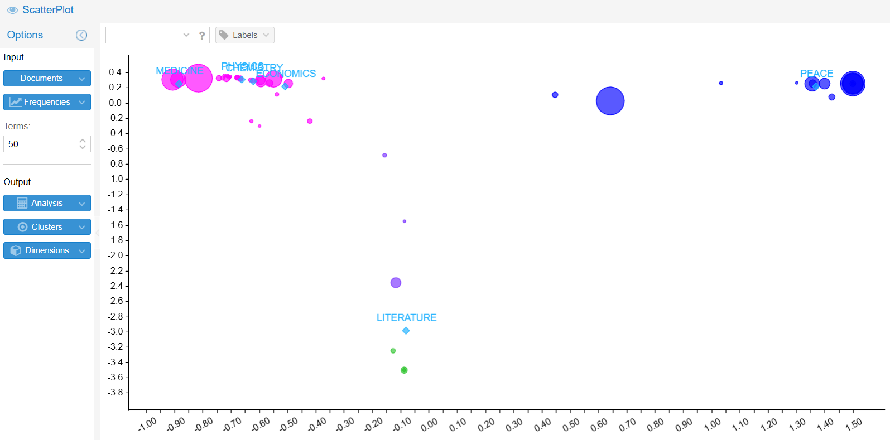
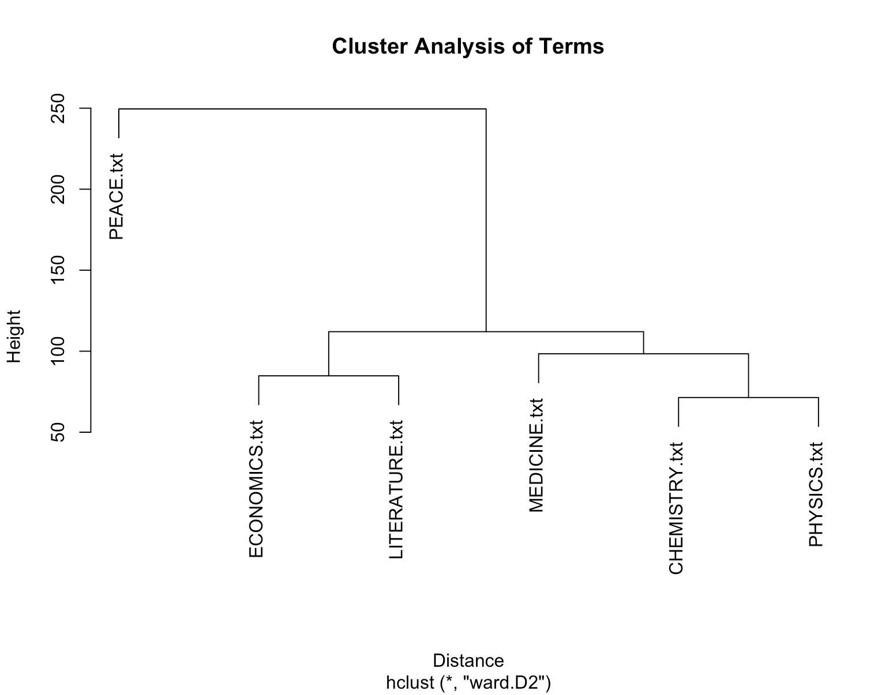

# Nobel Prize Citations: Textual Patterns of Merit (1925–2025)

**Completed collaborative academic project — Texts as Data, University of Padua**

## Objective

Explore how Nobel Prize citations describe achievement across six disciplines and how their language changes over time.

## Methods and tools

The team used R, RStudio and Voyant Tools for text preprocessing, lexical exploration, TF-IDF, correspondence analysis and hierarchical clustering.

The study compared Chemistry, Physics, Medicine & Physiology, Economics, Literature and Peace across three historical periods, accounting for the later introduction of the Economics prize.

## Key findings

- Physics, Chemistry and Medicine shared closely related scientific vocabulary.
- Peace citations formed a distinct humanitarian and institutional discourse.
- Economics combined scientific and socio-institutional language.

Findings were interpreted with attention to short texts, unequal category coverage and preprocessing choices.

## Methodology

1. Organise award citations by discipline and historical period.
2. Prepare text and term-document representations using targeted preprocessing and vocabulary selection.
3. Explore distinctive vocabulary with TF-IDF and lexical visualisations.
4. Compare lexical profiles through correspondence analysis and hierarchical clustering; interpret results alongside corpus limitations.

## Selected figures

### Lexical relationships across categories

Original Voyant scatterplot, Figure 19 in the team report. The visualisation explores differences between category-level lexical profiles; the plotted positions are exploratory outputs.

### Hierarchical clustering

Original dendrogram, Figure 28 in the team report. Physics and Chemistry merge first, followed by Medicine. Economics and Literature form another pair, while Peace joins at a greater distance. The original chart title and labels are preserved.

## Interpretation summary

| Evidence | Interpretation |
| --- | --- |
| Category-level lexical visualisation | Award categories differ in their language of achievement. |
| Hierarchical clustering | Scientific categories share lexical similarities; Peace has a more distinct profile. |
| Corpus and preprocessing constraints | Results are exploratory and depend on text coverage and analytical choices. |

## Practical relevance

The analytical approach can inform the exploration of customer feedback, survey responses and other unstructured text.

## Repository scope

This repository documents a completed team study. Source scripts, datasets and the full report are not included in this version.
